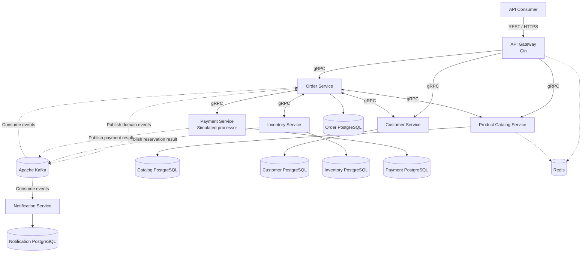

# Nexora

**A distributed commerce platform built with Go**

Nexora is a backend e-commerce platform built around independently deployable services, clear domain boundaries and reliable communication. It brings together core commerce capabilities such as product catalogues, customer management, inventory, order processing and payments in a cohesive distributed system.

The project explores practical backend engineering and distributed-systems concepts through a connected business workflow.

## Architecture

### Services

| Service | Responsibility |
|---|---|
| **API Gateway** | Provides a unified, versioned HTTP API and routes requests to the appropriate services. |
| **Product Catalog** | Manages products, categories, variants and catalogue information. |
| **Customer** | Manages customer profiles and delivery addresses. |
| **Order** | Owns order creation, purchase snapshots, lifecycle and checkout workflow coordination. |
| **Inventory** | Manages stock levels, availability and concurrency-safe reservations. |
| **Payment** | Handles simulated payment attempts, outcomes and refunds without connecting to a real payment provider. |
| **Notification** | Processes notification work from business events. |

Each service owns its domain logic and persistence. Services interact through defined contracts; no service directly accesses another service's database.

### Communication

| Mechanism | Purpose |
|---|---|
| REST/HTTPS | External client communication through the API Gateway |
| gRPC | Synchronous internal service-to-service communication |
| Apache Kafka | Asynchronous event-driven communication |

## Checkout workflow

1. A client submits an order request through the API Gateway.
2. The Order Service validates the request and retrieves required customer and product information through service contracts.
3. The Order Service creates the order and coordinates the checkout workflow.
4. The Inventory Service attempts to reserve the required stock and publishes the outcome.
5. When stock is reserved, the Payment Service performs a simulated payment attempt.
6. The Order Service processes the workflow outcome and updates the order lifecycle.
7. The Notification Service consumes relevant events and processes notification work.

The workflow uses asynchronous communication where appropriate and accounts for duplicate event delivery, transient failures and partial completion.

## Engineering focus

- **Service design:** bounded contexts, domain ownership and independent deployability.
- **Data ownership:** database-per-service and service-level transaction boundaries.
- **Distributed workflows:** Saga orchestration and compensating actions.
- **Messaging reliability:** transactional outbox, idempotent consumers, retries and dead-letter handling.
- **Concurrency:** safe inventory reservation and protection against overselling.
- **Consistency:** eventual consistency across service boundaries.
- **Resilience:** timeouts, graceful shutdown and controlled failure handling.
- **Observability:** structured logging, health checks, metrics and distributed tracing.
- **Testing:** unit, integration and end-to-end verification of business workflows.

## Technology stack

| Area | Technology |
|---|---|
| Language | Go |
| HTTP framework | Gin |
| Internal RPC | gRPC, Protocol Buffers |
| Event streaming | Apache Kafka |
| Databases | PostgreSQL |
| Caching | Redis |
| Containers | Docker, Docker Compose |
| Orchestration | Kubernetes |
| Metrics and dashboards | Prometheus, Grafana |
| Distributed tracing | OpenTelemetry |
| CI/CD | GitHub Actions |

## Design principles

- Each service owns its business domain and data.
- Cross-service communication happens through explicit APIs or events.
- No direct database access across service boundaries.
- Synchronous communication is used when an immediate response is required; asynchronous events are used to decouple workflows.
- Business logic remains independent of transport and persistence details.
- Reliability and failure handling are considered part of the system design.

---

**Nexora — a Go-based distributed commerce platform exploring the engineering behind reliable, event-driven systems.**
